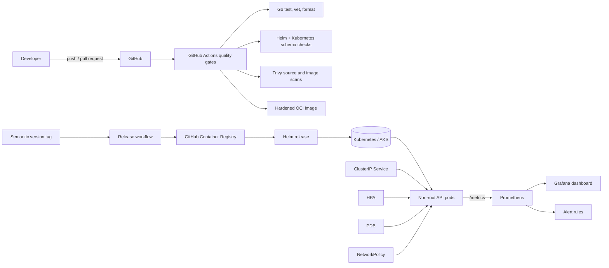

# AKS Reliability Lab

An original, production-style portfolio project for explaining how a small service moves from source code to a secure, observable Kubernetes workload. The emphasis is not application complexity; it is the reasoning behind delivery controls, health signals, safe rollouts, scaling, disruption handling, and least privilege.

This repository is a reproducible lab. It has not been presented as a system used in a professional production environment.

## What this demonstrates

- Dependency-free Go API with unit tests, graceful shutdown, structured JSON logs, request IDs, and Prometheus-compatible metrics
- Multi-stage, non-root `scratch` image with a built-in Docker health check and no shell or package manager at runtime
- Compose runtime hardening with dropped capabilities, a read-only filesystem, and `no-new-privileges`
- Kubernetes startup, readiness, and liveness probes; resource governance; zero-unavailable rolling updates; HPA; PDB; and NetworkPolicy
- Reusable Helm chart with development and production profiles and support for an externally managed Secret
- Least-privilege GitHub Actions for quality checks, manifest schema validation, image testing, Trivy scanning, multi-architecture publishing, SBOMs, and provenance
- Prometheus alert rules and an importable Grafana dashboard

## Architecture



The application does not require Azure-specific APIs, so the same chart can be tested on minikube or kind and deployed to AKS without changing workload semantics.

## Technology stack

| Area | Choice | Purpose |
|---|---|---|
| Application | Go standard library | Small attack surface and fast static builds |
| Container | Docker/BuildKit, `scratch` runtime | Reproducible multi-stage build with minimal runtime content |
| Local runtime | Docker Compose | Exercise the same hardened image locally |
| Orchestration | Kubernetes | Health management, rolling updates, autoscaling, and disruptions |
| Packaging | Helm | Environment-specific, repeatable releases |
| CI/CD | GitHub Actions and GHCR | Quality gates and tag-driven image publication |
| Security | Trivy, security contexts, NetworkPolicy | Source/image checks and runtime hardening |
| Observability | Prometheus format and Grafana JSON | Metrics, alerts, and operational visualization |

The CI and container builder use Go 1.26.8, a supported release at the time of writing. Kubernetes schemas target 1.35, one of the maintained release branches; AKS availability may lag upstream Kubernetes.

## Repository structure

```text
.
├── .github/
│   ├── dependabot.yml
│   └── workflows/           # CI and tag-based image publication
├── cmd/api/                 # Process entry point and graceful shutdown
├── internal/
│   ├── app/                 # HTTP endpoints, logging, request metrics, tests
│   └── config/              # Validated environment configuration and tests
├── deploy/
│   ├── helm/                # Reusable chart and environment profiles
│   └── kubernetes/          # Standalone Kustomize-ready manifests
├── docs/                    # Reference/licence assessment
├── monitoring/              # Grafana dashboard and optional PrometheusRule
├── compose.yaml
├── Dockerfile
├── Makefile
├── AGENTS.md
├── CONTRIBUTING.md
└── LICENSE
```

## Prerequisites

For application development: Go 1.23 or newer and GNU/BSD Make. For the complete path: Docker 24+, Helm 3.18+ or 4.x, and `kubectl` compatible with the target cluster. A local Kubernetes option such as minikube or kind is optional.

Prometheus Operator is required only for `ServiceMonitor` and `PrometheusRule`. Kubernetes Metrics Server is required for the HPA to receive CPU metrics.

## Local quick start

```bash
git clone https://github.com/venugopalmannuru-it/aks-reliability-lab.git
cd aks-reliability-lab
make test
make run
```

In another terminal:

```bash
curl -fsS http://127.0.0.1:8080/healthz
curl -fsS http://127.0.0.1:8080/readyz
curl -fsS http://127.0.0.1:8080/api/v1/info
curl -fsS http://127.0.0.1:8080/metrics
```

Runtime configuration is supplied through `PORT`, `APP_ENV`, `LOG_LEVEL`, `SHUTDOWN_DELAY`, and `SHUTDOWN_TIMEOUT`. Invalid ports, log levels, and durations fail fast.

## Docker and Compose

Build and run the immutable runtime image:

```bash
make docker-build
docker run --rm --name reliability-api \
  --read-only --cap-drop=ALL --security-opt=no-new-privileges:true \
  -p 8080:8080 aks-reliability-lab:local
```

Or use Compose:

```bash
make compose-up
docker compose ps
curl -fsS http://127.0.0.1:8080/readyz
make compose-down
```

Inspect the Docker-native health result with `docker inspect --format '{{json .State.Health}}' reliability-api` when running the container without `--rm`.

## Local Kubernetes with minikube

The Helm path is the recommended local deployment because it cleanly overrides the example registry.

```bash
minikube start --kubernetes-version=v1.35.2
docker build -t aks-reliability-lab:local .
minikube image load aks-reliability-lab:local

helm upgrade --install reliability deploy/helm/aks-reliability-lab \
  --namespace reliability-lab --create-namespace \
  -f deploy/helm/aks-reliability-lab/values-development.yaml \
  -f deploy/helm/aks-reliability-lab/examples/values-local.example.yaml

kubectl -n reliability-lab rollout status deployment/reliability-aks-reliability-lab
kubectl -n reliability-lab port-forward service/reliability-aks-reliability-lab 8080:80
```

Then call the endpoints shown in the quick start. The development profile disables the HPA so the demo does not depend on Metrics Server. To test autoscaling, enable it and run `minikube addons enable metrics-server` first.

For kind, replace the first and third commands with `kind create cluster` and `kind load docker-image aks-reliability-lab:local`.

## Helm install and upgrade

Validate all profiles before a release:

```bash
make helm-lint
helm template reliability deploy/helm/aks-reliability-lab \
  -f deploy/helm/aks-reliability-lab/values-production.yaml
```

Install an immutable published version by replacing the placeholders:

```bash
helm upgrade --install reliability deploy/helm/aks-reliability-lab \
  --namespace reliability-lab --create-namespace \
  -f deploy/helm/aks-reliability-lab/values-production.yaml \
  --set image.repository=ghcr.io/venugopalmannuru-it/aks-reliability-lab \
  --set image.tag=0.1.0
```

For application credentials, create a Secret outside Git and reference it:

```bash
kubectl -n reliability-lab create secret generic reliability-api-secrets \
  --from-literal=DEMO_API_KEY='<VALUE>'
helm upgrade reliability deploy/helm/aks-reliability-lab \
  --namespace reliability-lab --reuse-values \
  --set existingSecret=reliability-api-secrets
```

The application deliberately does not consume `DEMO_API_KEY`; the example demonstrates wiring without inventing a fake dependency. In a real system, use Azure Key Vault with the Secrets Store CSI Driver or an approved GitOps secret workflow instead of a command-line literal, which can enter shell history.

## CI/CD pipeline

Pull requests and pushes to `main` run three independent jobs:

1. Go formatting, vetting, race-enabled unit tests, coverage, and a static build.
2. Helm lint/rendering, Kustomize rendering, and Kubernetes 1.35 schema validation with kubeconform.
3. BuildKit image build, a live readiness check, repository scanning, and container vulnerability scanning.

No pull-request workflow can publish or deploy: its token has only `contents: read`. A semantic version tag such as `v0.1.0` starts the separate release workflow, which has `packages: write`, publishes `linux/amd64` and `linux/arm64` images to GHCR, and attaches SBOM/provenance attestations. Deployment remains an explicit Helm/GitOps decision so a registry publish cannot silently mutate a cluster.

## Monitoring and logging

Every request produces one JSON log event with request ID, route name, status, and duration. A caller-provided `X-Request-ID` is accepted only when it is short and contains safe characters; otherwise the service generates one. Route templates rather than arbitrary URLs are used as metric labels to avoid high-cardinality data.

Prometheus scrapes `/metrics`. Import `monitoring/grafana-dashboard.json` into Grafana and select a Prometheus data source. If Prometheus Operator is installed, set `serviceMonitor.enabled=true`; otherwise the default pod annotations support conventional discovery. Apply `monitoring/prometheus-alerts.yaml` only after its CRD exists.

## Security decisions

| Decision | Reason and trade-off |
|---|---|
| `scratch`, static binary, no shell | Reduces runtime surface; debugging uses logs and ephemeral containers rather than shelling into the app |
| Numeric non-root UID/GID 65532 | Works without `/etc/passwd` and satisfies restricted pod security |
| Read-only root filesystem, all capabilities dropped | Prevents common persistence and privilege paths; the app must remain stateless |
| Service account token disabled | The API has no Kubernetes API dependency |
| Deny-all egress | The current service needs no outbound connection; add narrowly scoped rules with a real dependency |
| Requests and limits | Makes scheduling predictable and enables CPU-based HPA behavior |
| External Secret reference | Keeps secret material out of chart values and Git history |
| Minimal workflow permissions | Separates untrusted validation from tag-authorized package publication |

The repository contains only placeholders. `deploy/kubernetes/examples/secret.example.yaml` must never be edited with a real value and committed.

## Rolling update and rollback demonstration

Use two published image tags and watch Kubernetes preserve availability:

```bash
kubectl -n reliability-lab get pods -w
helm upgrade reliability deploy/helm/aks-reliability-lab \
  --namespace reliability-lab --reuse-values --set image.tag=0.2.0
kubectl -n reliability-lab rollout status deployment/reliability-aks-reliability-lab
helm history reliability -n reliability-lab
helm rollback reliability 1 -n reliability-lab --wait
```

`maxUnavailable: 0`, `maxSurge: 1`, readiness gating, `minReadySeconds`, graceful SIGTERM handling, and the pre-stop delay cooperate so endpoints are removed before the old process exits. The PDB protects against voluntary disruptions; it does not protect against node failure or application defects.

## Troubleshooting

| Symptom | Check | Likely resolution |
|---|---|---|
| `ImagePullBackOff` | `kubectl describe pod -n reliability-lab <pod>` | Correct repository/tag, authenticate GHCR, or load the local image and use `pullPolicy: Never` |
| HPA shows `<unknown>` | `kubectl top pods -n reliability-lab` | Install/fix Metrics Server and confirm CPU requests exist |
| ServiceMonitor has no targets | Inspect Prometheus selectors | Add the labels expected by the installed Prometheus release to `serviceMonitor.labels` |
| Requests denied after NetworkPolicy | Inspect CNI support and source labels | Use a network-policy-capable CNI and explicitly permit the real ingress/monitoring controller |
| Pod exits during startup | `kubectl logs -n reliability-lab <pod>` | Correct invalid environment values; configuration intentionally fails fast |
| Rollout stalls | `kubectl describe deployment` and `kubectl get events` | Check readiness, capacity for `maxSurge`, image availability, and quotas |

## Cleanup

```bash
helm uninstall reliability -n reliability-lab
kubectl delete namespace reliability-lab
minikube delete
docker image rm aks-reliability-lab:local
```

Run only the commands that match resources you created. Namespace deletion removes everything in that namespace.

## Known limitations

- This repository provisions no AKS cluster, registry, DNS, ingress, TLS certificate, or cloud identity; those are environment-specific and billable concerns.
- CI renders and schema-validates resources but does not create an integration cluster.
- The custom metrics implementation is intentionally small and lacks histogram buckets, exemplars, and process/runtime collectors.
- HPA CPU targets need Metrics Server, and the optional monitoring resources need Prometheus Operator.
- NetworkPolicy enforcement depends on the cluster CNI. AKS version availability can lag upstream releases.
- Availability settings improve controlled maintenance behavior but do not prove an SLO without load, failure, and recovery tests.

## Future improvements

- Provision AKS, Azure Container Registry, workload identity, Key Vault CSI, and remote Terraform state in a separate infrastructure repository.
- Add an ephemeral kind smoke test and controlled pod/node disruption tests.
- Sign images and attestations with keyless Sigstore, then enforce admission policy.
- Replace hand-written metrics with Prometheus histograms and define latency/availability SLOs.
- Add OpenTelemetry traces and correlate trace IDs with structured logs.
- Introduce a GitOps controller only when a real multi-environment promotion workflow is defined.

## Interview discussion points

- Why startup, readiness, and liveness answer different questions and should not share failure semantics blindly
- How rolling strategy, readiness, termination grace, pre-stop delay, and PDB combine—and what each cannot guarantee
- Why CPU requests are both scheduling inputs and the denominator for utilization-based HPA decisions
- Why the pull-request pipeline cannot publish and why release publication is tag-gated
- When deny-all egress is appropriate and how to add a dependency without opening unrestricted outbound access
- Why an ultra-minimal image changes incident debugging practices

## References and attribution

- Conceptual reference: [`NagellaSivaKumar/javaproject-DevOpsLAB`](https://github.com/NagellaSivaKumar/javaproject-DevOpsLAB), itself a public fork. No licence was visible at assessment time, so no code or documentation was reused. See [`docs/reference-assessment.md`](docs/reference-assessment.md).
- [Go release policy](https://go.dev/doc/devel/release)
- [Kubernetes release information](https://kubernetes.io/releases/)
- [Kubernetes probes](https://kubernetes.io/docs/concepts/configuration/liveness-readiness-startup-probes/)
- [Kubernetes Pod Security Standards](https://kubernetes.io/docs/concepts/security/pod-security-standards/)
- [GitHub Actions security guidance](https://docs.github.com/en/actions/security-guides/security-hardening-for-github-actions)

All implementation and prose in this repository were created independently for this portfolio lab and are licensed under MIT.
